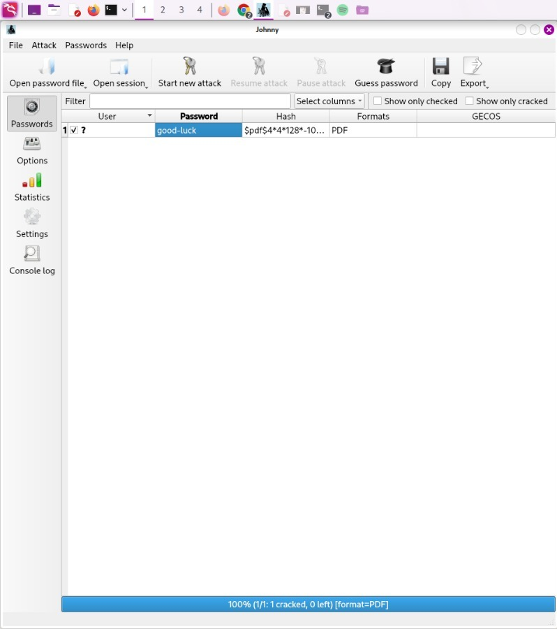
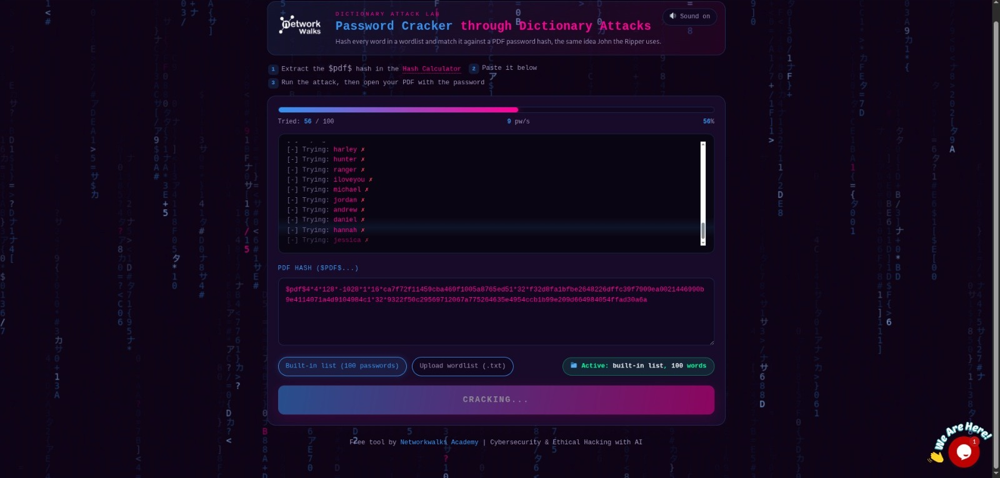
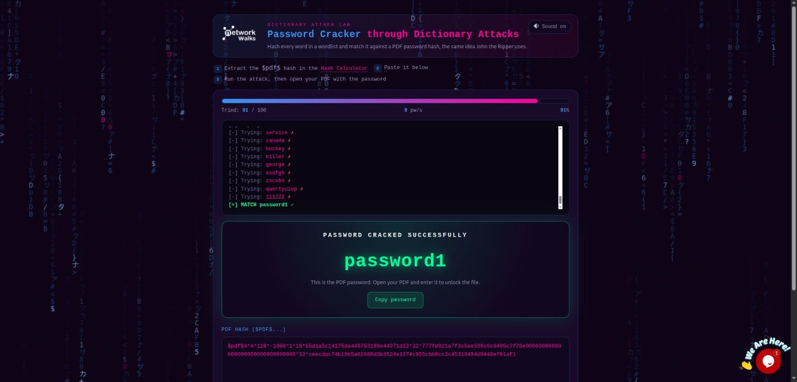

# 🔐 Networkwalks — Week 3: Password Cracking Labs

   

> Practical cybersecurity internship exercises demonstrating password recovery against **provided training PDFs only**.

## 📌 Overview

Week 3 of my Networkwalks cybersecurity internship covered two authorized PDF password-recovery labs, completed on my **existing Kali Linux operating system**, rather than the Windows environment shown in parts of the assignment instructions.

- **W3-PM1 — Password Cracking with John the Ripper (JTR):** Worked with the Johnny GUI to test a PDF-format hash and recover its password.
- **W3-PM2 — Password Cracking with Networkwalks Tools:** Used the browser-based Hash Calculator / Password Cracker workflow for a dictionary attack against a protected training PDF.

## 🎯 Objectives

1. Explore how password recovery works on protected PDF lab files.
2. Practice handling a PDF-compatible hash using the designated tools.
3. Observe dictionary-based password guessing and its limitations.
4. Document the practical evidence and password-security lessons.

## 🧰 Lab environment

| Item | Details |
| --- | --- |
| Operating system | Kali Linux (installed OS; no Windows VM used) |
| W3-PM1 tools | John the Ripper, Johnny GUI |
| W3-PM2 tools | Networkwalks Hash Calculator, Networkwalks Password Cracker |
| Scope | Networkwalks-provided password-protected PDF training files |
| Participant | Ibrahim Daramola |
| Cohort | B084 |

## 🧪 Module 1: John the Ripper / Johnny

The assigned workflow covered preparing a PDF-compatible hash, loading it into Johnny, running the password recovery attempt, and reviewing the result.

**Observed result:** The Johnny GUI recorded **1/1 cracked** for the PDF-format hash. The recovered lab password is recorded in the full report.



## 🧪 Module 2: Networkwalks password-cracking tools

The lab instructions use the Networkwalks Hash Calculator to extract a PDF-compatible hash and the Networkwalks Password Cracker to test password candidates. The participant's screenshots show the password-testing progress and a successful match using the built-in **100-word list**.

**Observed result:** A match was shown at **91/100 candidates**; the training PDF was opened afterward.





## 📋 Findings and lessons learned

- A password appearing in a small wordlist may be recovered during a dictionary attack.
- Password recovery results depend on the password, file protection, wordlist, and permitted test conditions.
- Strong, unique passwords and appropriate encryption settings improve protection.
- The screenshots document specific lab outcomes; they do **not** prove that unrelated files or systems are vulnerable.

## 📄 Full report

[**Read the Week 3 Practical Lab Report (PDF)**](Networkwalks_Week3_Password_Cracking_Report.pdf)

The report includes objectives, setup, separate results for both modules, screenshots, findings, recommendations, and limitations.

## 🗂️ Repository structure

```text
.
├── README.md
├── Networkwalks_Week3_Password_Cracking_Report.pdf
└── evidence/
    ├── pm1-johnny-success.jpeg
    ├── pm1-training-completion.jpeg
    ├── pm2-dictionary-progress.jpeg
    ├── pm2-dictionary-success.jpeg
    └── pm2-training-completion.jpeg
```

## ⚖️ Ethics and scope

All work described here concerns **authorized educational exercises** using provided training material. No real-world password targets, third-party accounts, or production environments were tested.

## 👤 Author

**Ibrahim Daramola** · Networkwalks B084  
[GitHub](https://github.com/Zaid-ul) · [LinkedIn](https://www.linkedin.com/in/ibrahim-daramola-4597a5292/)
